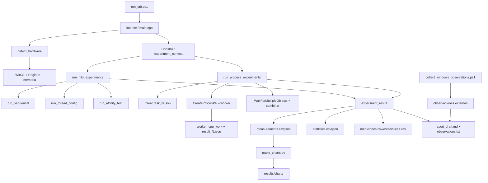

# Arquitectura y guía de revisión

Este documento explica qué hace el repositorio, cómo está dividido, cómo fluye una ejecución y cómo interpretar los archivos que genera. Está dirigido a quien deba revisar el código o reproducir el laboratorio en Windows.

## 1. Alcance

El proyecto implementa un laboratorio experimental de **procesos, hilos, concurrencia, paralelismo y planificación de CPU en Windows 10/11 de 64 bits**, usando C++17 y APIs Win32.

La comparación se basa en una misma carga CPU-bound determinista ejecutada como:

1. Línea base secuencial.
2. Un proceso con varios hilos C++ (`std::thread`).
3. Varios procesos Windows (`CreateProcessW`).
4. Varios hilos confinados al procesador lógico 0 mediante `SetThreadAffinityMask`.

El programa no contiene resultados reales del computador del estudiante. Los archivos de `results/` versionados son plantillas; los tiempos, CPU, memoria y hardware reales aparecen después de ejecutar `lab.exe` en Windows.

## 2. Vista general de la arquitectura



### Principio central

`main.cpp` coordina; no implementa la carga ni las APIs de cada experimento. Cada responsabilidad se encuentra en su módulo y todos los experimentos terminan en el mismo tipo `experiment_result`. Esto permite serializar, validar y comparar las filas con un solo flujo.

## 3. Flujo de una ejecución normal

1. `run_lab.ps1` comprueba que exista el ejecutable.
2. El script abre el Administrador de tareas, salvo que se use `-NoTaskManager`.
3. `lab.exe` registra la versión objetivo, instala el manejador de `Ctrl+C` y muestra el PID.
4. `detect_hardware()` obtiene CPU, sockets, núcleos, procesadores lógicos, grupos, arquitectura, memoria, SO y compilador.
5. Se calcula la lista de configuraciones segura:
   - Hilos: potencias de dos hasta el límite, procesadores lógicos exactos y una configuración de sobre-suscripción cuando aplica.
   - Procesos: lista equivalente limitada a 16 unidades y reducida si queda menos de 1 GB de memoria disponible.
6. Se crea `experiment_context` con iteraciones, repeticiones, configuraciones, timeout, directorio de salida y bandera de cancelación.
7. Se ejecuta la línea base secuencial repetida `N` veces.
8. Se ejecutan las configuraciones de hilos, también con `N` repeticiones.
9. Se ejecuta la prueba de afinidad con cuatro hilos en el procesador lógico 0, salvo `--skip-affinity` o si el equipo no tiene al menos dos procesadores lógicos.
10. Se ejecutan los procesos Windows, salvo `--skip-processes`.
11. Se escriben las salidas detalladas, estadísticas, formato compatible con Linux, observaciones e informe.
12. Se vuelven a leer los archivos principales y se valida el checksum de cada ejecución.

El programa espera dos segundos antes de iniciar las pruebas. Ese intervalo permite organizar el Administrador de tareas y preparar la captura.

## 4. Módulos de código

### 4.1 Encabezados (`include/`)

| Archivo | Responsabilidad | Contrato principal |
|---|---|---|
| `args.hpp` | Opciones de línea de comandos. | `program_options`, `parse_args`. |
| `hardware_info.hpp` | Modelo y serialización del hardware. | `hardware_info`, `detect_hardware`, `hardware_to_json/csv`. |
| `workload.hpp` | Carga determinista y tareas del worker. | `cpu_work`, `worker_range`, JSON de tareas/resultados. |
| `measurement.hpp` | Tipos y utilidades de medición. | `timed_scope`, conversiones y utilización. |
| `experiment_context.hpp` | Modelo compartido de configuración y resultados. | `experiment_context`, `experiment_result`. |
| `thread_experiment.hpp` | API de secuencial, hilos y afinidad. | `run_hilo_experiments` y pruebas individuales. |
| `process_experiment.hpp` | API del experimento con procesos. | `run_process_experiments`. |
| `csv_writer.hpp` | Escritura CSV con escape de campos. | `csv::writer`. |
| `json.hpp` | JSON mínimo sin dependencia externa. | `json::value`, `json::object`, parseo y serialización. |
| `terminal.hpp` | Consola, colores, secciones, progreso y mensajes. | `terminal::context` y funciones `write_*`. |
| `report_draft.hpp` | Modelo del borrador técnico. | `report_blocks`, render Markdown. |

### 4.2 Fuentes (`src/`)

| Archivo | Qué implementa |
|---|---|
| `main.cpp` | Punto de entrada, modo worker, coordinación, serialización, estadísticas, validación y resumen final. |
| `args.cpp` | Parser de opciones y texto de ayuda. |
| `hardware_info.cpp` | Detección Win32/Registro, plan de configuraciones y exportación de hardware. |
| `workload.cpp` | `SplitMix64`, suma modular, reparto de rangos y JSON de workers. |
| `measurement.cpp` | `steady_clock`, `GetProcessTimes` y `GetProcessMemoryInfo`. |
| `thread_experiment.cpp` | Secuencial, `std::thread`, `join`, afinidad y verificación. |
| `process_experiment.cpp` | Archivos de tarea/resultado, `CreateProcessW`, espera, timeout y combinación. |
| `csv_writer.cpp` | Escape y escritura de CSV. |
| `json.cpp` | Serializador y parser JSON mínimo. |
| `terminal.cpp` | Salida de consola con colores y mensajes de estado. |
| `report_draft.cpp` | Tablas, estadísticas, limitaciones, preguntas y Markdown final. |

## 5. Carga CPU-bound y verificación

`workload.cpp` implementa:

```text
cpu_work(begin, end)
```

Para cada `i` del rango aplica una mezcla `SplitMix64` y suma el valor en módulo `2^63`. El acumulador es local al hilo o proceso; no hay un acumulador global compartido durante la carga.

El reparto usa:

```text
base = total_iterations / workers
remainder = total_iterations % workers
```

Los primeros `remainder` workers reciben una iteración adicional. La unión de los rangos es exactamente `[0, total_iterations)`.

Al terminar, los parciales se combinan con suma modular. La primera medición secuencial define `baseline_verification`; una ejecución paralela es válida únicamente si su checksum combinado coincide con esa referencia.

Esto valida que la comparación de tiempos no esté ocultando trabajo omitido o una cantidad distinta de iteraciones.

## 6. Experimentos

### Secuencial

- Un worker lógico.
- Define la referencia de tiempo y checksum.
- Se repite igual que las demás configuraciones.

### Hilos

- Un solo proceso.
- Cada `std::thread` recibe un rango independiente.
- Cada hilo escribe solamente en su propia posición de resultados parciales.
- `join()` finaliza la sincronización.
- El tiempo de CPU se obtiene del proceso completo, por lo que puede superar el tiempo de pared cuando hay paralelismo.

### Afinidad y concurrencia

- Cuatro hilos.
- Cada hilo solicita la máscara `1`, correspondiente al procesador lógico 0 del grupo actual.
- Se registra `affinity_requested`, `affinity_applied`, `affinity_mask` y, si falla, `win32_error`.
- La afinidad demuestra concurrencia con avance intercalado, pero no debe interpretarse como paralelismo físico simultáneo.

### Procesos

- El padre calcula los rangos y crea un JSON de tarea por worker.
- Cada hijo se ejecuta con el mismo `lab.exe` en modo `--worker`.
- El hijo lee `begin`, `end` y `output_path`, ejecuta la misma carga y escribe un JSON independiente.
- El padre crea todos los hijos antes de esperar, usa `WaitForMultipleObjects`, lee cada resultado y combina los checksums.
- Cada proceso tiene su espacio de direcciones independiente.
- Los archivos temporales se eliminan al finalizar, excepto con `--save-evidence`.
- `worker_cpu_time_ms` es la suma del CPU reportado por los hijos y se usa en el formato compatible con Linux.

## 7. Medición y significado de las métricas

| Métrica | Fuente | Interpretación |
|---|---|---|
| `wall_time_ms` / `wall_s` | `std::chrono::steady_clock` | Tiempo transcurrido de reloj. |
| `process_cpu_time_ms` / `cpu_s` | `GetProcessTimes` | CPU del proceso y sus hilos. |
| `worker_cpu_time_ms` | JSON de cada hijo | Suma de CPU de procesos trabajadores. |
| `cpu_utilization_percent` / `util_pct` | `CPU / pared * 100` | Puede superar 100% con varios hilos/procesadores. |
| `verification_value` / `checksum` | `cpu_work` | Resultado para verificar trabajo equivalente. |
| `speedup` | `T_base / T_configuracion` | Aceleración respecto a la media secuencial. |
| `efficiency` | `speedup / workers` | Eficiencia relativa; el CSV detallado la expresa como razón. |
| `efficiency_pct` | `speedup / workers * 100` | Eficiencia en porcentaje del formato Linux-compatible. |
| `peak_memory_bytes` | `GetProcessMemoryInfo` | Pico de working set del proceso medido. |

Las ejecuciones con checksum incorrecto, timeout, fallo de lanzamiento o resultado incompleto se conservan como filas fallidas, pero no se incluyen en las estadísticas agregadas válidas.

## 8. Contratos de salida

### Salida detallada

`measurements.csv` y `measurements.json` contienen, entre otros:

```text
run_id, experiment, mode, workers, logical_processors,
physical_cores, iteration_count, repeat, wall_time_ms,
process_cpu_time_ms, worker_cpu_time_ms, verification_value,
verification_ok, affinity_requested, affinity_applied,
affinity_mask, peak_memory_bytes, exit_code, win32_error_code,
cpu_utilization_percent, notes
```

### Salida estadística detallada

`statistics.csv` y `statistics.json` agrupan solo filas verificadas por experimento, modo y número de workers. Incluyen media, mínimo, máximo, rango, desviación estándar, speedup, eficiencia y mejora.

### Formato comparable con Linux

`mediciones.csv` conserva el esquema compacto del repositorio Linux:

```text
rep,mode,units,logical_cpus,total_iters,wall_s,cpu_s,util_pct,checksum
```

`estadisticas.csv` conserva su esquema agregado:

```text
mode,units,n,mean_s,min_s,max_s,range_s,stdev_s,
mean_cpu_s,mean_util_pct,speedup,efficiency_pct
```

Los modos Windows se nombran `hilos_windows` y `procesos_windows` para no presentarlos como implementaciones POSIX. `secuencial` y `afinidad_1lp` conservan el significado común.

## 9. Scripts auxiliares

| Script | Uso |
|---|---|
| `configure_build.ps1` | Detecta CMake/compilador y prepara el directorio de build. |
| `build.ps1` | Ejecuta configuración y compilación CMake en Release o Debug. |
| `run_lab.ps1` | Ejecuta la batería, abre Task Manager y enumera archivos esperados. |
| `collect_windows_observations.ps1` | Recopila CPU mediante CIM, contadores y datos del proceso `lab`. |
| `make_charts.py` | Lee `measurements.csv` y genera PNG de tiempo, speedup, eficiencia, procesos/hilos y CPU. |

Los scripts no inventan mediciones. Si una herramienta no está disponible, deben dejar constancia de la limitación.

## 10. Evidencias manuales

`evidence/README.md` define nueve evidencias identificadas como E01–E09:

- CPU y topología desde PowerShell.
- Procesadores lógicos en Task Manager.
- `lab.exe` visible en Detalles.
- CPU durante secuencial.
- CPU durante varios hilos.
- Actividad por procesador lógico.
- Prueba de afinidad.
- Procesos hijos.
- Errores y limitaciones.

La apertura automática de Task Manager facilita E02–E08, pero no reemplaza las capturas del estudiante. Una captura posterior a la ejecución no prueba la utilización dinámica durante la carga.

## 11. Construcción y ejecución reproducible

En Windows PowerShell:

```powershell
.\scripts\configure_build.ps1
.\scripts\build.ps1
.\scripts\run_lab.ps1
```

Ejecución sin abrir Task Manager:

```powershell
.\scripts\run_lab.ps1 -NoTaskManager
```

Prueba funcional rápida:

```powershell
.\build\lab.exe --quick
```

La prueba rápida sirve para validar el flujo, pero no para el informe final.

### Parámetros recomendados

```text
--output <dir>
--iterations <n>
--repetitions <n>
--max-workers <n>
--max-processes <n>
--timeout-seconds <n>
--skip-processes
--skip-affinity
--save-evidence
--quick
--no-color
--quiet
```

## 12. Limitaciones y decisiones de interpretación

- Este proyecto solo compila en Windows; las APIs Win32 no tienen implementación Linux.
- La CPU de procesos se reporta mediante archivos de resultado de los hijos y puede tener cuantización o diferencias respecto a contadores del sistema.
- La afinidad con máscara `1` se interpreta dentro del grupo de procesadores actual; equipos con múltiples grupos requieren cautela.
- El scheduler puede migrar hilos cuando no hay afinidad; el programa no afirma que cada hilo permaneció en un núcleo concreto.
- La utilización y los tiempos dependen de carga de fondo, frecuencia dinámica, energía, antivirus, memoria y planificación.
- Windows y Linux no deben compararse causalmente si se ejecutan en equipos diferentes o con cargas/comunicación diferentes.
- `perf`, `mpstat`, `sched_getcpu`, `fork` y `RUSAGE_CHILDREN` son herramientas/API Linux; sus salidas no se simulan en Windows.

## 13. Lista de revisión para un evaluador

1. Confirmar que `CMakeLists.txt` incluye todos los `.cpp` listados en `src/`.
2. Revisar que `workload.cpp` sea común a secuencial, hilos y procesos.
3. Confirmar que cada configuración conserva `iteration_count` y valida checksum.
4. Confirmar tres repeticiones por defecto y línea base repetida.
5. Revisar `measurements.csv/json` para filas completas y tipos correctos.
6. Revisar `mediciones.csv/estadisticas.csv` si se comparará con Linux.
7. Confirmar que la afinidad registra éxito o error, sin afirmar aplicación cuando falla.
8. Confirmar que `--save-evidence` conserva `results/tmp` y que por defecto se limpia.
9. Ejecutar `collect_windows_observations.ps1` y contrastar hardware con `hardware.*`.
10. Revisar capturas E01–E09 y completar el análisis final en lugar de copiar hipótesis automáticas.

## 14. Inventario del repositorio

```text
.
├── AGENT.md                         Reglas técnicas y criterios del laboratorio
├── CMakeLists.txt                   Configuración de compilación C++17/Win32
├── README.md                        Guía de entrada y comandos rápidos
├── LICENSE                          Licencia del proyecto
├── docs/ARCHITECTURE.md             Este mapa técnico y guía de revisión
├── include/                         Contratos y tipos públicos por funcionalidad
├── src/                             Implementaciones C++ por funcionalidad
├── scripts/                         Automatización de build, ejecución, observación y gráficas
├── results/                         Plantillas y resultados generados localmente
└── evidence/README.md               Checklist de evidencias manuales
```

`results/` no debe interpretarse como un conjunto de mediciones del autor: sus archivos versionados son plantillas o ejemplos estructurales, no evidencia del hardware del revisor.
